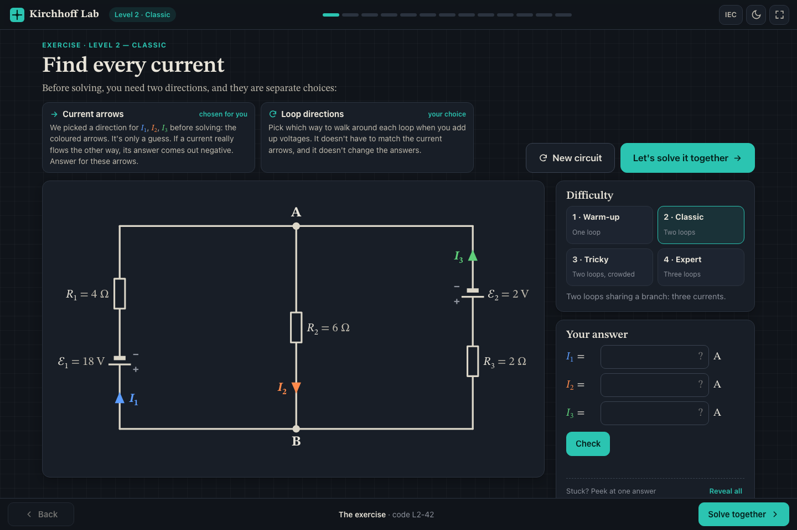
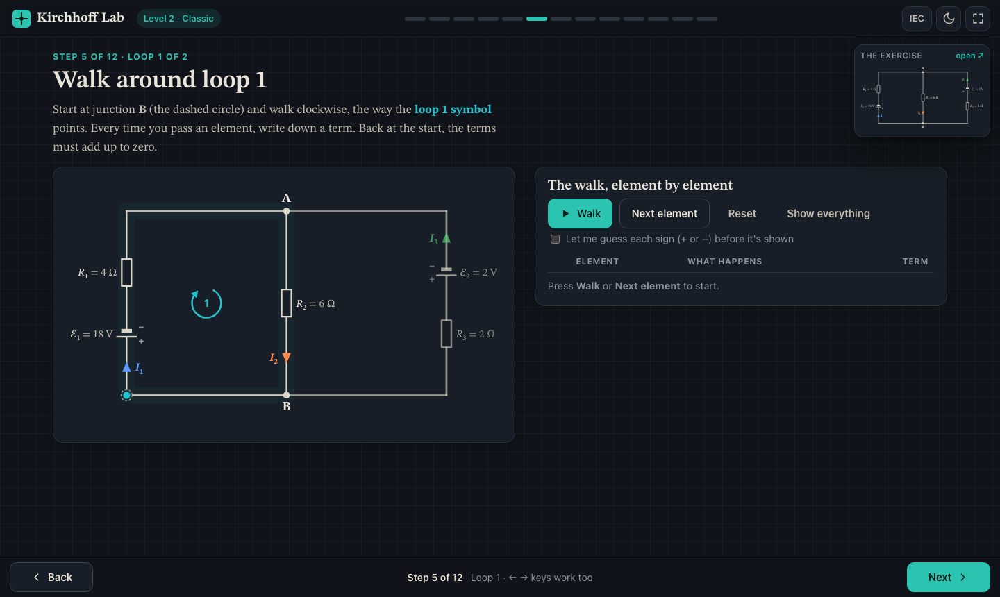
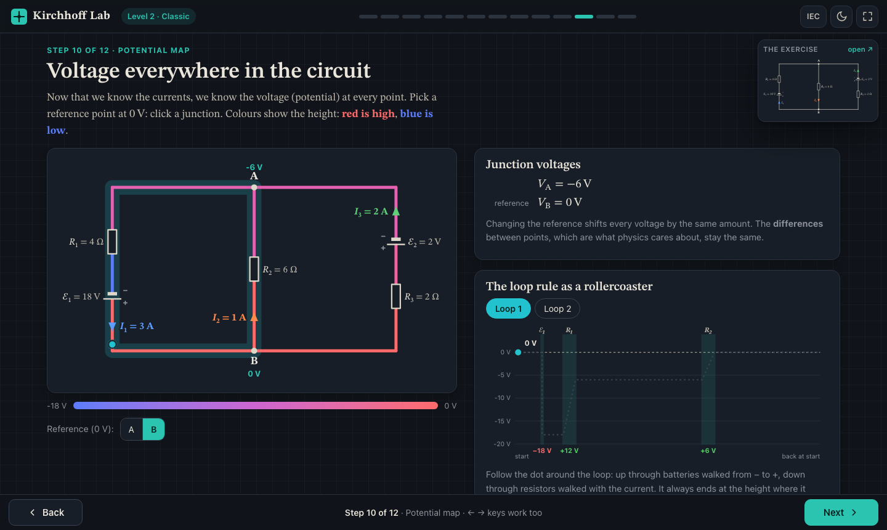

# Kirchhoff Lab

Practise [Kirchhoff's circuit rules](https://en.wikipedia.org/wiki/Kirchhoff%27s_circuit_laws) on random circuits, then work through the full solution one step at a time.

**Open it:** https://ssbarbee.github.io/kirchhoff-lab/



## Why it exists

Kirchhoff Lab is here to help students learn Kirchhoff's rules properly, not just memorise them.

The rules themselves are short. What trips students up is everything around them:

- picking current directions
- getting the signs right while walking a loop
- not panicking when an answer comes out negative
- keeping track of several equations at once

Textbooks have only a handful of worked examples. Once those are used up, there's nothing left to practise on and no way to check your work.

This app gives students:

- **Endless practice.** A new circuit every time, at four levels, always with whole-number answers.
- **Instant feedback.** Check answers right away, or peek at one when stuck.
- **A full worked solution for every circuit.** Each step gets its own page, so students can see where their own attempt went wrong.
- **The why, not only the how.** The junction rule is [conservation of charge](https://en.wikipedia.org/wiki/Charge_conservation) and the loop rule is [conservation of energy](https://en.wikipedia.org/wiki/Conservation_of_energy). The voltage map and energy check make both visible.

It's meant to support teaching, not replace it. Use it for homework, revision, or on a projector to solve a circuit together with the class.

## How it works

1. **Solve it.** You get a circuit with every battery and resistor given. Find each current and press **Check**.
2. **Peek if stuck.** Each answer sits under its own card. Reveal one, or all of them.
3. **Solve it together.** A guided walkthrough, one step per page:
   - the two rules
   - reading the circuit
   - choosing directions
   - the junction rule
   - walking each loop, element by element
   - collecting the equations
   - solving the system
   - reading the answer, including negative currents
   - a voltage map with a "rollercoaster" for each loop
   - an energy check
4. **Again.** Press **New circuit** (or `N`) for a fresh circuit at the same level.

| Level | Circuit |
|---|---|
| 1 · Warm-up | A single loop: one current, only the loop rule |
| 2 · Classic | Two loops sharing a branch: three currents |
| 3 · Tricky | Crowded branches, a battery in the middle, arrows pointing any which way |
| 4 · Expert | Three loops, three junctions, five currents |

Every circuit is randomly generated and has whole-number answers.

## The key idea: two free choices

Before writing any equation, you make two choices. Neither one changes the physics.

1. **A current arrow for each branch.** It defines what I₁, I₂, … mean. You can't know the real direction yet, so you guess. A negative answer just means the current flows against the arrow. Keep the same arrows from start to finish.
2. **A walking direction for each loop.** It's the direction you go around the loop while adding up voltage changes. It doesn't have to match the current arrows, and each loop can be chosen on its own. Walking the other way only multiplies that equation by −1.

When you walk a loop, each element adds a term:

- **Resistor, walking along its arrow:** −IR
- **Resistor, walking against its arrow:** +IR
- **Battery, crossing from − to +:** +ℰ (the opposite way gives −ℰ)

Back at the start, the terms add up to zero.

In this app the current arrows are drawn for you, so everyone's answers can be checked against the same signs. Some arrows deliberately point the "wrong" way, so negative answers come up often.

<table>
  <tr>
    <td></td>
    <td></td>
  </tr>
</table>

## For teachers

- **Same circuit for the whole class.** Every circuit has a code such as `L2-42`. **Copy link** on the exercise page gives a link like `https://ssbarbee.github.io/kirchhoff-lab/#L2-42`, and everyone who opens it gets exactly that circuit. Students can also type the code into the box on the exercise page.
- **Projector friendly.** Press `F` for full screen. Light and dark themes are in the top bar.
- **Resistor symbols.** Switch between the IEC box (Europe) and the US zigzag in the top bar.
- **Works offline.** The whole app is one `index.html` with no dependencies. Download it from this repo (open `index.html` and use the download button) and open it in any current browser: Chrome, Edge, Firefox or Safari, on Windows or Mac. Opened from a file, **Copy** shares the circuit code instead of a link.

## Keyboard

| Key | Action |
|---|---|
| `→` / `←` | Next / previous step |
| `N` | New circuit, same level (on the exercise page) |
| `F` | Full screen |
| `Esc` | Back to the step you came from, after opening the exercise from the minimap |
| `Enter` | Check your answers (in an answer box) |

## Learn more

On Wikipedia:

- [Kirchhoff's circuit laws](https://en.wikipedia.org/wiki/Kirchhoff%27s_circuit_laws): the junction rule and the loop rule
- [Gustav Kirchhoff](https://en.wikipedia.org/wiki/Gustav_Kirchhoff): the physicist who stated them in 1845
- [Ohm's law](https://en.wikipedia.org/wiki/Ohm%27s_law): the voltage across a resistor, V = IR
- [Electromotive force](https://en.wikipedia.org/wiki/Electromotive_force): what the battery symbol ℰ stands for
- [Voltage](https://en.wikipedia.org/wiki/Voltage): electric potential difference, the "height" in the voltage map
- [Charge conservation](https://en.wikipedia.org/wiki/Charge_conservation): why the currents into a junction equal the currents out
- [Conservation of energy](https://en.wikipedia.org/wiki/Conservation_of_energy): why the voltages around a loop add up to zero
- [System of linear equations](https://en.wikipedia.org/wiki/System_of_linear_equations) and [Gaussian elimination](https://en.wikipedia.org/wiki/Gaussian_elimination): the algebra in the "Solve" step
- [Mesh analysis](https://en.wikipedia.org/wiki/Mesh_analysis) and [nodal analysis](https://en.wikipedia.org/wiki/Nodal_analysis): systematic methods built on the same rules, for larger circuits

## Development

The app is built from the files in `src/`:

- `core.js`: circuit generator and solver
- `view.js`: SVG drawing and animation
- `pages.js`: the exercise and walkthrough steps
- `app.js`: state, navigation and the minimap
- `head.html`: styles and page shell

```sh
./build.sh               # concatenates src/ into index.html
node test/core.test.js   # checks 6,000 generated circuits end to end
```

Pushing to `main` redeploys the site through GitHub Pages.

Suggestions and fixes are welcome as pull requests. `main` is protected, so changes go through a pull request.

## License

[MIT](LICENSE). Free to use, copy, change and share, in class or anywhere else.
